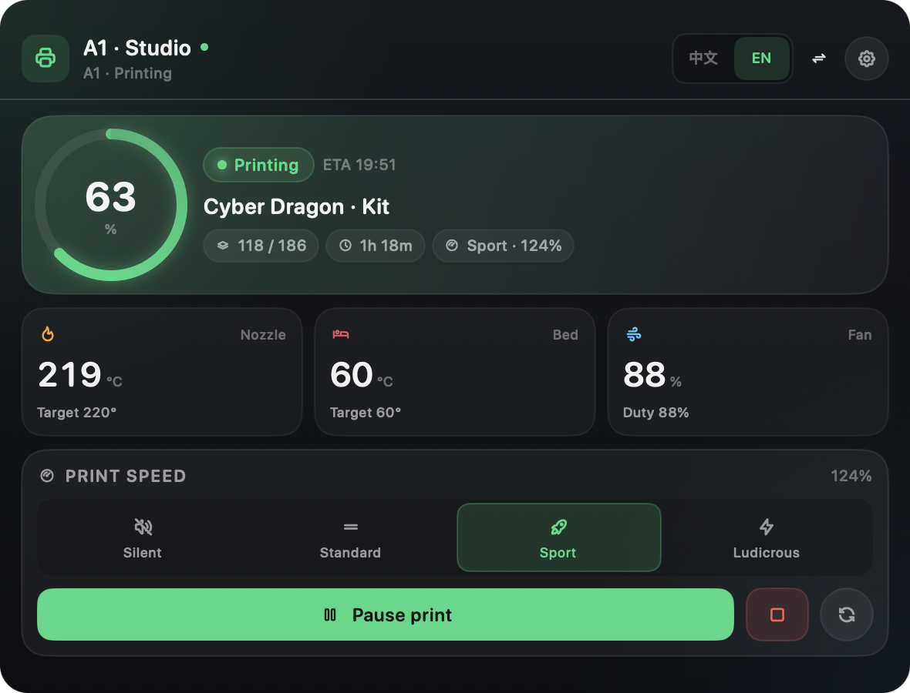
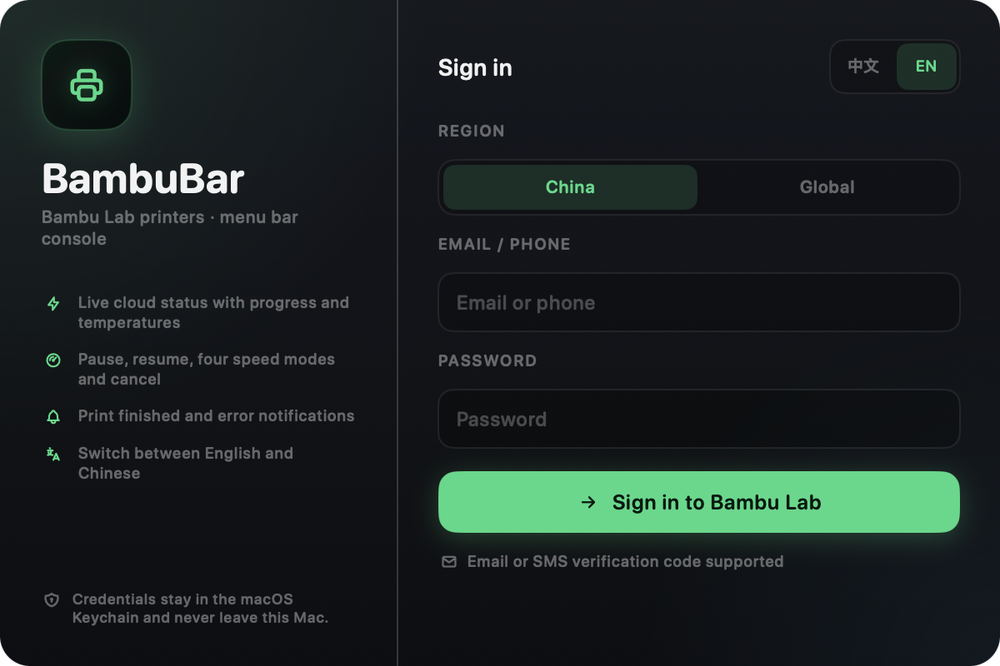
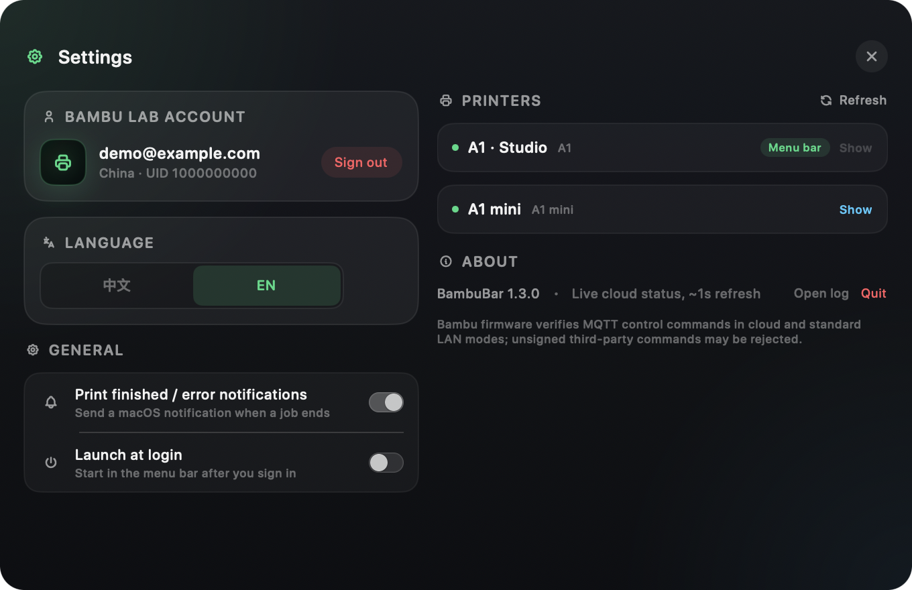

# BambuBar

<p align="center">
  
</p>

<p align="center">
  <strong>A native macOS menu bar app for Bambu Lab 3D printers.</strong><br>
  Live progress at a glance, with temperature and print controls one click away.
</p>

<p align="center">
  <a href="https://github.com/GuoDaiYi/BambuBar/actions/workflows/build.yml"></a>
  <a href="https://github.com/GuoDaiYi/BambuBar/releases/latest"></a>
  
  
  
  
</p>

BambuBar lives in the macOS menu bar and connects directly to your Bambu Lab cloud account. It shows the current print in a compact progress ring, lets you switch between multiple printers, and exposes the controls you actually need during a print — without opening a slicer or a browser.

Available in **English** and **Simplified Chinese** — switch languages from the globe menu on the sign-in screen or in Settings. The choice is remembered across launches.

---

## Features

- **Menu bar at a glance** — a custom progress ring plus percentage, pause/finish/error states, and printer online status.
- **Multiple printers** — every printer stays connected in the background; switch the menu bar target from the header.
- **Real-time job status** — state, progress, current/total layers, remaining time, ETA and speed mode.
- **Download and unpack phases** — recognises cloud file transfer and preparation (Downloading / Unpacking) before the print starts.
- **Print controls** — pause, resume and cancel (with a confirmation dialog) from the popover.
- **Four speed modes** — Silent, Standard, Sport and Ludicrous, mapped to Bambu's `spd_lvl` values.
- **Temperature and fan control** — view nozzle, bed and fan values; adjust nozzle/bed targets and part-cooling fan with G-code commands.
- **Bilingual UI** — English and Simplified Chinese, switchable at runtime with large segmented controls.
- **Update checks** — the app checks GitHub Releases and shows a download badge when a newer version exists.
- **Auto-hide main panel** — the dashboard closes after 10 seconds of inactivity, or when you switch to another window/app. Sign-in and Settings stay open until you close them.
- **Native notifications** — print completion and failure notifications with a monochrome printer thumbnail.
- **Tabler icon set** — MIT-licensed line icons bundled with the app.
- **Launch at login** — optional `SMAppService` login item.
- **No Dock icon, no third-party server** — a lightweight `LSUIElement` app built with SwiftUI and AppKit.

## Screenshots

### English

| Dashboard | Sign in | Settings |
| :---: | :---: | :---: |
|  |  |  |

## Requirements

- macOS 13 Ventura or later (Apple Silicon or Intel)
- Xcode Command Line Tools (`xcode-select --install`) to build from source
- A Bambu Lab account (China or Global region) with at least one printer bound

## Installation

### Download the app

Download **BambuBar-1.3.0-macOS.dmg** from the [latest release](https://github.com/GuoDaiYi/BambuBar/releases/latest), open it, and drag **BambuBar** into **Applications**. The DMG contains a universal binary for Apple Silicon and Intel Macs.

The app is ad-hoc signed but not notarized. If macOS refuses to launch it, right-click the app and choose **Open**, or run:

```bash
xattr -dr com.apple.quarantine /Applications/BambuBar.app
```

### Build from source

```bash
git clone https://github.com/GuoDaiYi/BambuBar.git
cd BambuBar
./build.sh
open build/BambuBar.app
```

To install it for daily use:

```bash
cp -R build/BambuBar.app /Applications/
open /Applications/BambuBar.app
```

The app is ad-hoc signed by the build script. If macOS refuses to open it after downloading a release, right-click the app and choose **Open**, or remove the quarantine attribute:

```bash
xattr -dr com.apple.quarantine /Applications/BambuBar.app
```

### First run

1. Click the printer icon in the menu bar.
2. Pick **China** or **Global**, enter your Bambu Lab account and password.
3. Bambu may send a verification code by **email or SMS**; enter the 6-digit code.
4. Your bound printers appear automatically. Use **Switch** in the header to choose the printer shown in the menu bar.
5. Open **Settings** to choose the language, notifications, and launch at login.

The password is never stored. The cloud access token is kept in the macOS Keychain (with a `0600` file fallback) and is only sent to Bambu Lab's own cloud endpoints.

## Supported printers

| Feature | A1 / A1 mini | P1 series | X1 series |
| --- | :---: | :---: | :---: |
| Cloud status monitoring | ✅ | ✅ (expected) | ✅ (expected) |
| Unsigned print controls | ⚠️ firmware dependent | ⚠️ firmware dependent | ⚠️ firmware dependent |

BambuBar was designed around the A1 family. Other printers that expose the same Bambu cloud MQTT payloads will likely work, but have not been verified. The app uses an unofficial cloud API and may need updates when Bambu changes its service. Newer firmware can reject unsigned third-party control commands; see **Known limitations**.

## Privacy

- No analytics, telemetry, or third-party backend.
- Account passwords are never written to disk.
- The access token is stored in the macOS Keychain when available. If Keychain access fails, it falls back to `~/Library/Application Support/BambuBar/session.json` with owner-only permissions.
- Cloud requests go only to `api.bambulab.cn` / `api.bambulab.com` and `cn.mqtt.bambulab.com` / `us.mqtt.bambulab.com`.

## Known limitations

- **Firmware authorization:** newer Bambu firmware verifies MQTT control commands. In cloud mode and standard LAN mode, third-party pause/resume/cancel/speed commands can be rejected with `mqtt message verify failed` and HMS `0500-0500-0001-0007`. BambuBar detects this, shows a warning and disables the controls instead of retrying in a loop.
- To use third-party controls, the printer must be in **LAN Only mode with Developer Mode enabled**. That disconnects it from Bambu Cloud, so Bambu Handy and remote access stop working for that printer.
- Without signed command support, BambuBar works reliably as a cloud status monitor; use Bambu Handy or Bambu Studio for control on locked-down firmware.
- The status UI is intentionally limited to progress, temperatures, speed and controls; camera, AMS and the printer-status panel were removed.
- The app is not notarized. Build it locally or allow it in **System Settings → Privacy & Security** if you download a prebuilt app.

## Disclaimer

BambuBar is an independent community project and is not affiliated with, endorsed by, or supported by Bambu Lab. Bambu Lab and the printer names are trademarks of their respective owners. The Bambu cloud API is unofficial and may change without notice. Use the app at your own risk, especially when sending control commands to a running printer.

## License

MIT — see [LICENSE](LICENSE).

## Acknowledgements

- [OpenBambuAPI](https://github.com/Doridian/OpenBambuAPI) for documenting the Bambu cloud HTTP/MQTT protocol.
- [Tabler Icons](https://tabler.io/icons) (MIT) for the interface icon set.
- The [Bambu Studio](https://github.com/bambulab/BambuStudio) network plugin and community reverse-engineering projects for protocol details.
- Everyone who shared their printer's MQTT reports so tools like this can exist.
