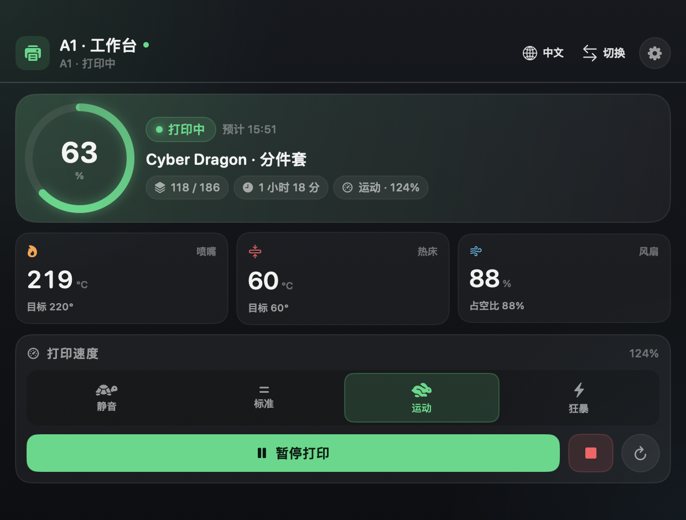
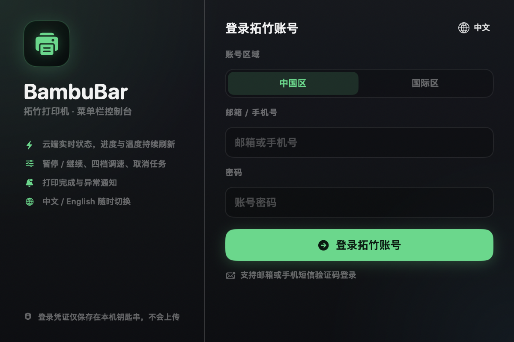
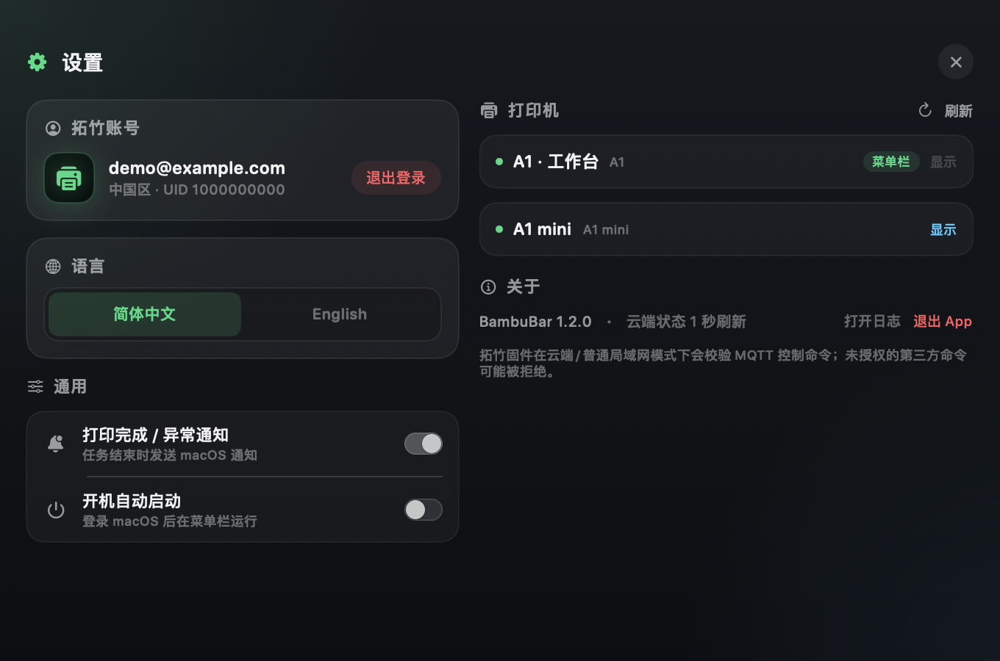

# BambuBar

<p align="center">
  
</p>

<p align="center">
  <strong>原生 macOS 菜单栏拓竹打印机助手。</strong><br>
  实时进度、温度显示、暂停/继续与四档调速。
</p>


BambuBar 常驻 macOS 菜单栏，直接连接拓竹云账号。菜单栏里就能看到当前打印进度，点击面板即可切换打印机、暂停/继续、调速、取消任务和查看温度。

界面支持 **简体中文 / 英文**，可在登录页右上角或设置中随时切换，选择会被记住。

---

## 功能

- **菜单栏进度环**：百分比、打印状态、在线状态一眼可见；图标为白色单色模板，自动适配菜单栏。
- **多打印机切换**：所有打印机在后台保持连接，在面板右上角切换菜单栏显示哪一台。
- **实时任务状态**：状态、进度、当前层/总层数、剩余时间、预计完成时间、速度档位、错误码。
- **下载 / 解压阶段**：打印开始前识别并显示「下载中 / 解压中」。
- **打印控制**：暂停、继续、取消（取消前有确认弹窗）。
- **四档速度**：静音、标准、运动、狂暴。
- **温度与风扇**：查看喷嘴/热床/风扇；可调整喷嘴温度、热床温度和模型风扇。
- **系统通知**：打印完成或异常时发送 macOS 通知。
- **开机启动**：可选 `SMAppService` 登录项。
- **无 Dock 图标、无第三方服务器**：SwiftUI + AppKit 原生实现。

## 截图

### 简体中文

| 主面板 | 登录 | 设置 |
| :---: | :---: | :---: |
|  |  |  |

## 系统要求

- macOS 13 Ventura 或更高版本（Apple Silicon / Intel）
- 一个已绑定打印机的拓竹账号（中国区或国际区）

## 安装

### 下载安装

从 [Releases](https://github.com/GuoDaiYi/BambuBar/releases/latest) 下载 **BambuBar-1.2.0-macOS.dmg**，打开后把 **BambuBar** 拖进 **Applications**。安装包内含 Apple Silicon + Intel 通用二进制。

App 使用本地 ad-hoc 签名，未经过公证。如果 macOS 阻止打开，请右键 App 选择「打开」，或执行：

```bash
xattr -dr com.apple.quarantine /Applications/BambuBar.app
```

### 从源码编译

```bash
git clone https://github.com/GuoDaiYi/BambuBar.git
cd BambuBar
./build.sh
open build/BambuBar.app
```

需要安装 Xcode Command Line Tools（`xcode-select --install`）。

### 第一次使用

1. 点击菜单栏里的打印机图标。
2. 选择「中国区」或「国际区」，输入拓竹账号和密码。
3. 如果拓竹发送验证码，输入邮箱或短信里的 6 位验证码。
4. 登录后会自动读取已绑定的打印机；用面板右上角「切换」选择菜单栏显示哪一台。
5. 在「设置」里切换语言、开启通知和开机启动。

密码不会被保存。云端 Token 存在 macOS 钥匙串中（失败时回退到权限为 `0600` 的文件），并且只发送给拓竹官方云服务。

## 支持的机型

| 功能 | A1 / A1 mini | P1 系列 | X1 系列 |
| --- | :---: | :---: | :---: |
| 云端状态监控 | ✅ | ✅（预期） | ✅（预期） |
| 未签名控制命令 | ⚠️ 取决于固件 | ⚠️ 取决于固件 | ⚠️ 取决于固件 |

BambuBar 主要针对 A1 系列开发。其他使用相同拓竹云 MQTT 数据结构的机型大概率可用，但尚未逐一验证。使用的云端接口并非官方公开 API，拓竹变更服务时可能需要更新。

## 工作原理

```
SwiftUI MenuBarExtra
        │
        ├── CloudAPI（URLSession）
        │     ├── 登录 / Token / 邮箱或短信验证码
        │     ├── GET /v1/iot-service/api/user/bind
        │     └── 中国区 / 国际区
        │
        ├── BambuCloud
        │     └── MQTT 3.1.1 over TLS 8883
        │           ├── device/{serial}/report
        │           ├── device/{serial}/request
        │           └── pause / resume / stop / print_speed / gcode_line
```

- MQTT 基于 `Network.framework` 从零实现（CONNECT / SUBSCRIBE / PUBLISH / PING，命令使用 QoS 1，自动重连），无第三方依赖。
- 云 MQTT 用户名 `u_{uid}`，密码为拓竹 Access Token。
- 程序会识别 `mqtt message verify failed` 等命令拒绝原因，并在界面上提示。

## 隐私

- 无统计、无遥测、无第三方后端。
- 不保存账号密码。
- Token 优先保存在 macOS 钥匙串；失败时保存在 `~/Library/Application Support/BambuBar/session.json`（仅当前用户可读）。
- 云端请求只发往 `api.bambulab.cn` / `api.bambulab.com` 和 `cn.mqtt.bambulab.com` / `us.mqtt.bambulab.com`。

## 已知限制

- **固件授权校验**：新版拓竹固件会校验 MQTT 控制命令。在云端模式和普通局域网模式下，第三方发送的暂停/继续/取消/调速命令可能被拒绝，返回 `mqtt message verify failed` 和 HMS `0500-0500-0001-0007`。BambuBar 会识别该错误、显示提示并禁用控制按钮，避免反复触发错误。
- 如需第三方控制，打印机必须使用 **LAN Only 模式并开启 Developer Mode**；这会使该打印机断开拓竹云，Bambu Handy 和远程访问将不可用。
- 在锁定固件上，BambuBar 可作为云端状态监控使用；控制请使用 Bambu Handy 或 Bambu Studio。
- 界面已移除摄像头、AMS 和打印机状态面板，只保留进度、温度、速度和打印控制。
- App 未公证，下载后可能需要右键「打开」。

## 从源码构建

```bash
./build.sh      # 编译 x86_64 + arm64 通用 App
./release.sh    # 生成 DMG 和 ZIP 到 build/
```

## 免责声明

BambuBar 是独立社区项目，与拓竹科技（Bambu Lab）无隶属关系，也未获得其背书。Bambu Lab 及相关打印机名称归其各自所有者。云端接口并非官方公开 API，可能随时变化。使用本软件（尤其是向正在打印的机器发送控制命令）风险自负。

## 许可证

MIT，详见 [LICENSE](LICENSE)。

## 致谢

- [OpenBambuAPI](https://github.com/Doridian/OpenBambuAPI)：云端 HTTP/MQTT 协议文档
- [Bambu Studio](https://github.com/bambulab/BambuStudio) 及社区逆向项目提供的协议细节
- 所有分享打印机 MQTT 数据的社区贡献者
